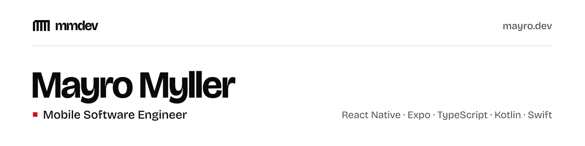

<picture>
  <source media="(prefers-color-scheme: dark)" srcset="./assets/banner-dark.svg" />
  
</picture>

## Hi there, I'm Mayro Myller 👋

### I'm a Mobile Software Engineer in Brazil!

I design and build complete products for mobile and web, from prototype to store release.
I've been working with React Native since 2022.

Today I work with React Native, Expo and TypeScript. I build and maintain apps in production, taking care of architecture, performance and the CI/CD pipeline with EAS Build and EAS Workflows, including store releases and OTA updates via EAS Update. I always measure before changing anything. I'm currently studying software architecture, system design, AI-assisted development and product design.

Call me to chat, it will be a pleasure to exchange experiences and ideas. Thanks!

### Connect with me:

---

## Explore the code
Some of my repositories may have something that can help you. Write a review and send a pull request.

 

> 💬 "Every hero has a code."
> ― Westworld
